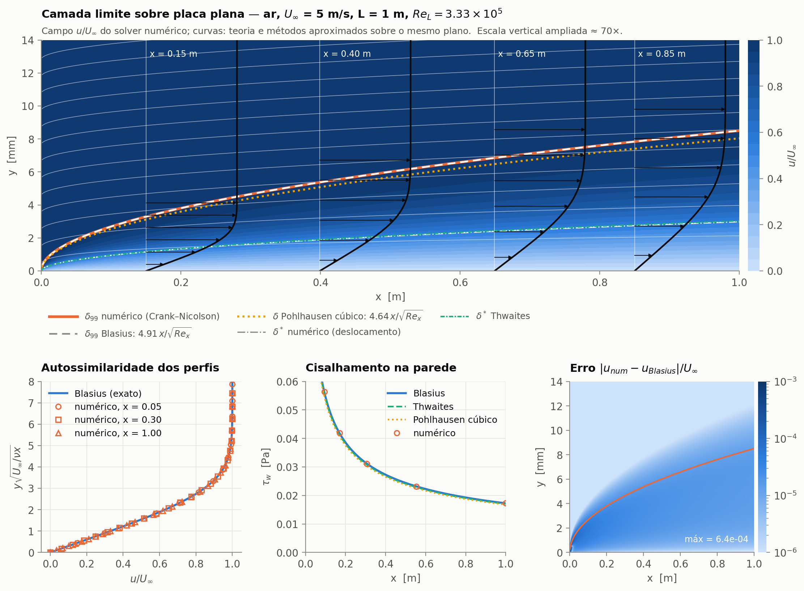
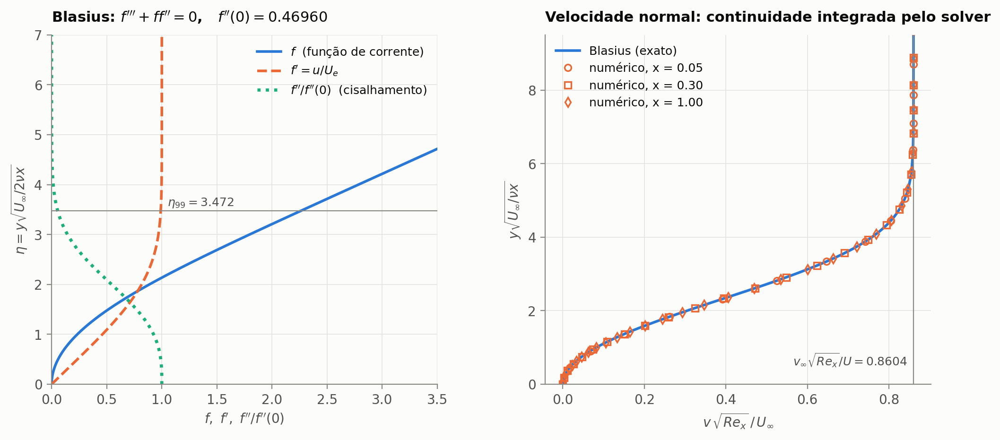
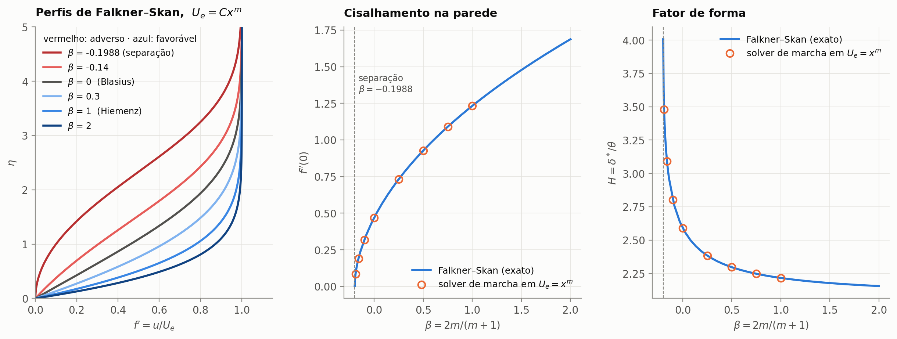
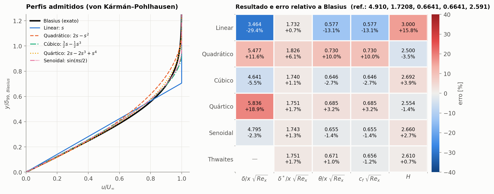
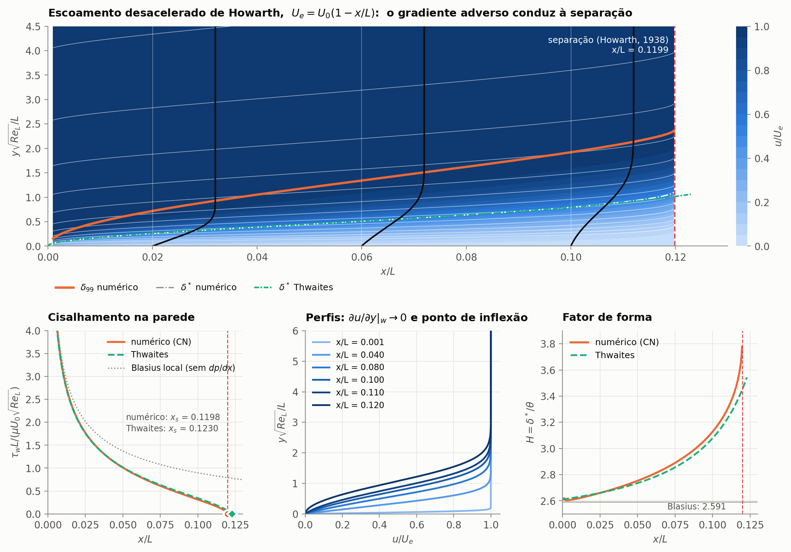
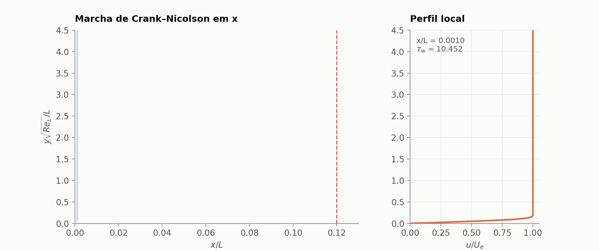
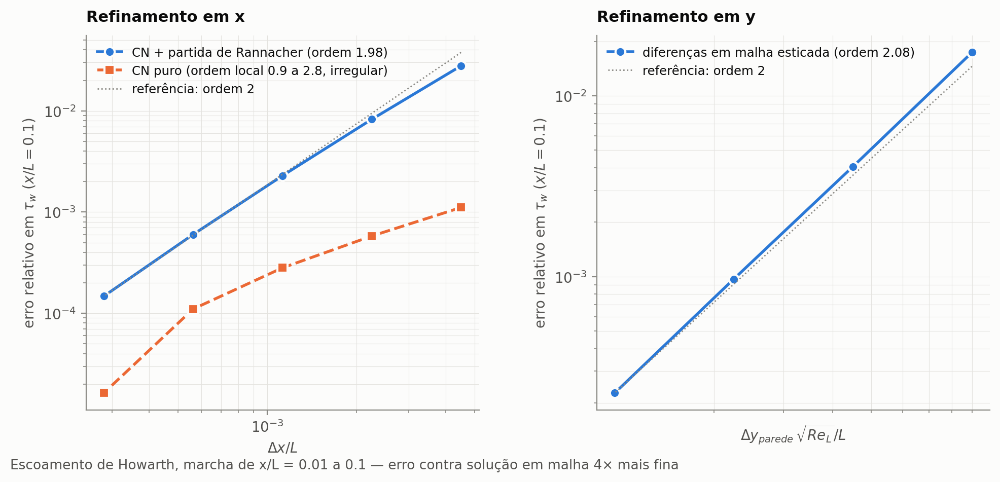
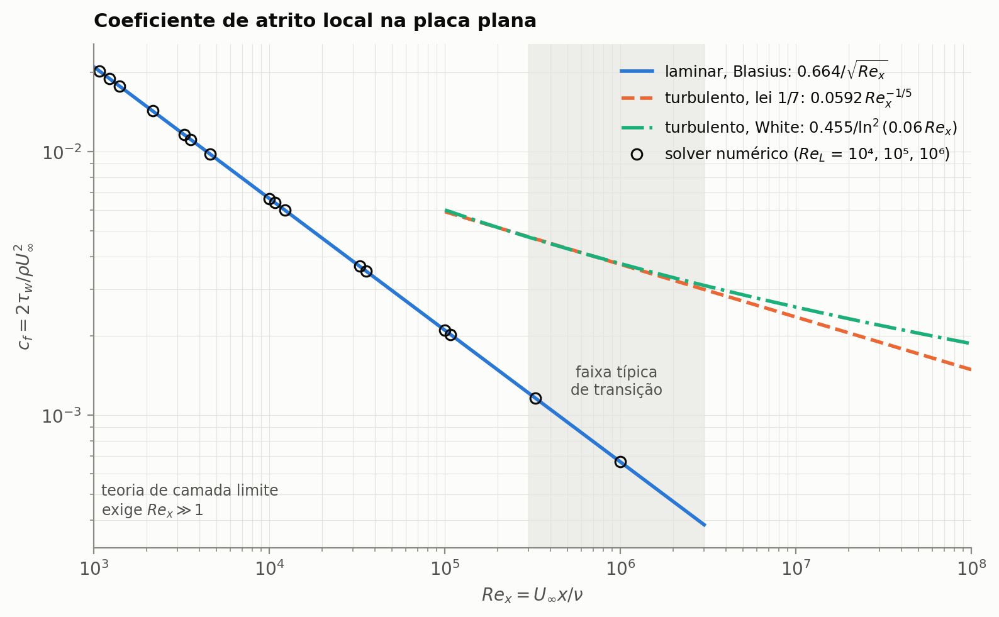

# Camada limite laminar 2D: teoria e numérica no mesmo plano

[](https://github.com/eniocarlossoilook34/boundary-layer-2d/actions/workflows/ci.yml)


Este projeto resolve as **equações de Prandtl** da camada limite laminar com um solver próprio
(diferenças finitas, marcha de Crank–Nicolson) e coloca o resultado **no mesmo plano 2D** que
as soluções analíticas e os métodos aproximados da teoria clássica: Blasius, Falkner–Skan,
von Kármán–Pohlhausen e Thwaites. Cada resultado é validado contra valores da literatura por
testes automatizados.



> **Como ler a figura.** O fundo é o campo $u/U_\infty$ calculado pelo solver (ar a 5 m/s sobre
> uma placa de 1 m). A curva laranja é a espessura $\delta_{99}$ numérica; a tracejada branca, a
> fórmula de Blasius $4.91\,x/\sqrt{Re_x}$. As duas se sobrepõem em todo o domínio. Os perfis
> pretos com setas são os perfis de velocidade nas estações indicadas, e as linhas brancas finas
> são linhas de corrente (sobem levemente por causa do deslocamento $\delta^*$). No canto inferior
> direito, a diferença entre o solver e Blasius fica abaixo de $10^{-3}$ em todo o campo.

---

## Destaques

| | Este projeto | Referência | Erro |
|---|---|---|---|
| Atrito na placa plana, $c_f\sqrt{Re_x}$ | 0.66409 | 0.66411 (Blasius) | 0.003 % |
| Espessura de deslocamento, $\delta^*\sqrt{Re_x}/x$ | 1.7209 | 1.7208 | 0.006 % |
| Fator de forma $H$ | 2.5911 | 2.5911 | < 0.01 % |
| Separação de Howarth, $x_s/L$ | 0.1198 | 0.1199 (Howarth, 1938) | 0.1 % |
| Separação de Howarth, Thwaites | 0.1230 | 0.1199 | 2.6 % (limite do método) |
| Cunhas de Falkner–Skan, $f''(0)$ para $-0.19 \le \beta \le 1$ | — | solução exata | < 0.1 % |
| Ordem de convergência em $x$ / em $y$ | 1.98 / 2.08 | 2 (teórica) | — |

---

## O que está implementado

| Módulo | Conteúdo |
|---|---|
| [`similarity.py`](src/boundary_layer/similarity.py) | Blasius e família de Falkner–Skan $f''' + ff'' + \beta(1-f'^2) = 0$ por colocação, com continuação até a separação ($\beta = -0.1988$); campos $u$, $v$ reconstruídos no plano físico |
| [`marching.py`](src/boundary_layer/marching.py) | Solver das equações de Prandtl para **qualquer** $U_e(x)$: Crank–Nicolson em $x$, malha esticada em $y$, Picard + sistema tridiagonal, partida de Rannacher, detecção de separação por extrapolação de Goldstein |
| [`integral.py`](src/boundary_layer/integral.py) | Equação integral de von Kármán: cinco perfis de Pohlhausen e o método de Thwaites com correlações de Cebeci–Bradshaw |
| [`turbulent.py`](src/boundary_layer/turbulent.py) | Correlações turbulentas empíricas (lei 1/7, White), só como contexto |
| [`docs/teoria.md`](docs/teoria.md) | **Derivação completa**: ordem de grandeza → Prandtl → similaridade → métodos integrais → separação → método numérico |

---

## Resultados

### 1. Similaridade de Blasius
O solver não sabe nada sobre similaridade, mas perfis calculados em estações diferentes colapsam
numa única curva quando plotados em $\eta = y\sqrt{U_\infty/\nu x}$. A velocidade normal $v$, obtida
integrando a continuidade, também coincide com $(\eta f' - f)/\sqrt{2}$.



### 2. Gradiente de pressão: família de Falkner–Skan
Para $U_e = Cx^m$ o problema continua autossemelhante. O solver de marcha, aplicado a esses
escoamentos, reproduz $f''(0)$ e $H$ exatos desde o ponto de estagnação ($\beta = 1$) até perto
da separação ($\beta = -0.19$).



### 3. Métodos integrais: o que eles acertam e o que erram
Perfis admitidos erram muito a espessura $\delta$ (até 29 %), mas acertam $\delta^*$ e $\theta$
com poucos por cento, porque a equação integral impõe a conservação de quantidade de movimento,
não a forma local do perfil. Thwaites fica a cerca de 1 % em tudo.



### 4. Separação: escoamento desacelerado de Howarth
Com $U_e = U_0(1 - x/L)$ o gradiente adverso faz $\tau_w \to 0$: o perfil desenvolve um ponto de
inflexão e $H$ sobe de 2.6 para ~3.8. O solver localiza a separação em $x_s/L = 0.1198$
(literatura: 0.1199) extrapolando $\tau_w^2 \propto (x_s - x)$, o comportamento da singularidade
de Goldstein. Thwaites prevê 0.1230.



<p align="center"></p>

### 5. Verificação: ordem de convergência
O refino de malha confirma segunda ordem em $x$ e em $y$. O painel da esquerda mostra um ponto
sutil: com Crank–Nicolson puro, o erro do perfil inicial não é amortecido e a ordem observada
oscila entre ~1 e ~3. Nessas malhas o erro absoluto do CN puro até é menor, mas um erro que não
cai de forma previsível não serve para estimar a incerteza numérica. Avançar os dois primeiros
intervalos com Euler implícito (partida de Rannacher) devolve a ordem 2 limpa, o que permite
extrapolação de Richardson e uma estimativa de erro confiável.



### 6. Contexto: laminar × turbulento
Como as equações escaladas não dependem de $Re$, uma única solução numérica cobre qualquer número
de Reynolds. Acima da transição, o atrito turbulento (correlações empíricas) é várias vezes maior.



---

## Uso

```bash
git clone https://github.com/SEU-USUARIO/boundary-layer-2d.git
cd boundary-layer-2d
pip install -e ".[dev]"
pytest                          # 22 testes de validação
python scripts/make_figures.py  # gera figures/ (~2 min)
```

Escoamento externo arbitrário em poucas linhas:

```python
import numpy as np
from boundary_layer import marching, thwaites

ue  = lambda x: 1 - 0.5 * x**2          # U_e(x)/U_0, qualquer função suave
due = lambda x: -x

x = marching.marching_grid(1e-3, 1.5, 800)
r = marching.solve(ue, x, due=due)       # u(x, y), v(x, y), tau_w, delta*, theta, H...

print(r.separated, r.x_separation)
print(thwaites(ue, np.linspace(0, 1.5, 5001), due=due).x_separation)
```

As grandezas estão escaladas ($x/L$, $y\sqrt{Re_L}/L$, $u/U_0$, $v\sqrt{Re_L}/U_0$), de modo que uma
solução vale para qualquer $Re_L$. Veja a [seção 2 da teoria](docs/teoria.md#2-adimensionalização-usada-no-código).

## Estrutura

```
├── src/boundary_layer/   # pacote: similarity, marching, integral, turbulent, plotting
├── tests/                # validação contra a literatura (pytest)
├── scripts/              # make_figures.py
├── figures/              # figuras geradas
├── docs/teoria.md        # fundamentação teórica completa
└── .github/workflows/    # CI: lint + testes em Python 3.10–3.13
```

## Limitações e próximos passos

* **Escopo:** escoamento laminar, 2D, incompressível e permanente. As equações de Prandtl
  deixam de valer na separação; não há interação viscosa–invíscida.
* **Próximos passos naturais:** camada limite térmica (equação da energia, efeito de $Pr$);
  método inverso para atravessar a separação; modelo de turbulência algébrico (Cebeci–Smith)
  com critério de transição; comparação com uma simulação de Navier–Stokes completa (p. ex.
  OpenFOAM) para quantificar o erro da aproximação de camada limite em $Re$ moderado.

## Referências

Schlichting & Gersten, *Boundary-Layer Theory* (2017); White, *Viscous Fluid Flow* (2006);
Cebeci & Bradshaw, *Momentum Transfer in Boundary Layers* (1977). Lista completa, incluindo os
artigos originais, em [`docs/teoria.md`](docs/teoria.md#12-referências).

## Autor

**Enio Carlos Silva Oliveira** — graduação em Engenharia, 6º período. [LinkedIn](#) · [e-mail](#)

Licença [MIT](LICENSE).
